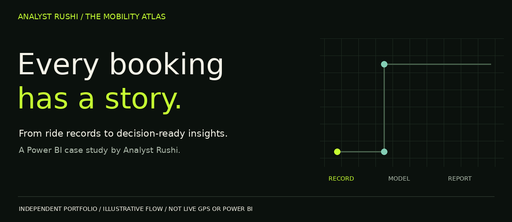
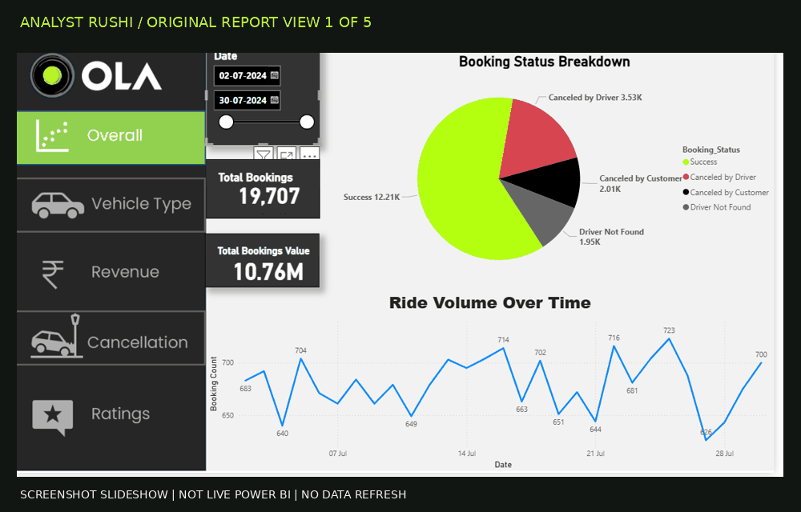
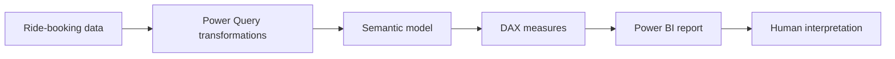

<!-- POWERBI_PREVIEWS -->


## Original report walkthrough


[Explore the case study website](https://anyalstrushi.github.io/PowerBI/showcase/) · [Build and deployment](https://github.com/AnyalstRushi/PowerBI/actions/workflows/publish-showcase.yml)

Availability requires successful deployment. Animated previews use original screenshots; they are not live Power BI. Independent portfolio, not affiliated with Ola.

<!-- /POWERBI_PREVIEWS -->

# Analyst Rushi / OLA Ride Operations — Power BI

Independent mobility-analytics portfolio with an Ola-inspired charcoal, lime and ivory showcase. Not affiliated with Ola.

[Branded HTML showcase source](showcase/index.html) · [Download original PBIX](OLA%20Project%20DashBOard.pbix) · [Power BI theme JSON](themes/analyst-rushi-mobility.json) · [Existing presentation](docs/PRESENTATION.html)

## Original report preview


The HTML showcase adds a responsive five-view screenshot gallery, optional timed playback, an illustrative animated analytics route and a conceptual architecture story. It does not embed a live Power BI report or change the PBIX.

## Explore the original views

| View 2 | View 3 |
|---|---|
|  |  |

| View 4 | View 5 |
|---|---|
|  |  |

## Conceptual architecture



This architecture has not been extracted from or audited against the binary PBIX. Validate KPI definitions and model relationships before repeating business conclusions.

## Run the visual showcase locally

```bash
python -m http.server 8000
```

Open http://localhost:8000/showcase/. A GitHub HTML source link displays code; it is not itself a hosted web application. GitHub Pages publishing is automated; successful public deployment still requires verification.

## Theme and branding

- Display brand: Analyst Rushi.
- Main palette: graphite #0B110D, acid lime #C6FF32, ivory #F5F3E8; mint #83CDB4 and amber #F2B65B accents.
- Theme file: themes/analyst-rushi-mobility.json. Import and validate it in Power BI Desktop before saving a themed report.
- Original PBIX and screenshots are unchanged. Website colors do not automatically recolor report visuals.

## Real interactive Power BI

Not connected. A published report or approved secure embed URL is required. Do not publish confidential data publicly. Timed screenshot playback is an animated preview, not real-time data or interactive Power BI.

## Supporting documentation

[Requirements](docs/PROJECT_REQUIREMENTS.md) · [Project walkthrough](docs/PROJECT_PRESENTATION.md)

## Verification status

- [x] Use existing report screenshot filenames.
- [x] Add branded HTML source and a separate theme JSON.
- [ ] Browser QA and mobile visual inspection.
- [ ] Validate theme import in Power BI Desktop.
- [ ] Audit report metrics and semantic model.
- [ ] Verify hosting and connect an authorized live report.

GitHub: [AnyalstRushi](https://github.com/AnyalstRushi) · Email: rushiwavhal33@gmail.com
